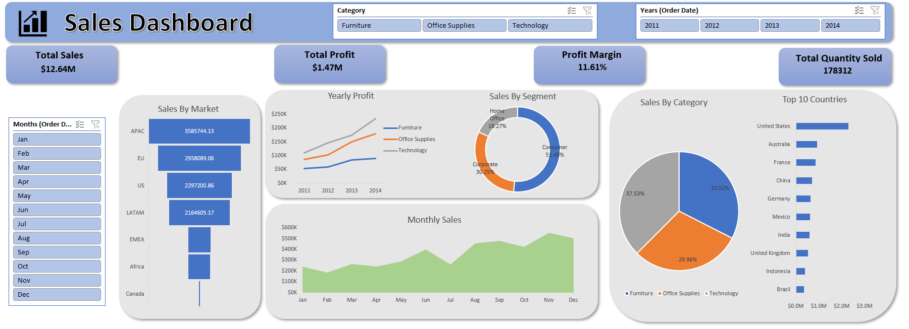

# Retail Sales Analysis

**An end-to-end retail sales analysis project using PostgreSQL and
Microsoft Excel.**

This project explores four years of retail transaction data (2011--2014)
to understand sales growth, profitability, customer and product
performance, regional contribution, and the relationship between
discounts and profit. PostgreSQL is used for data validation and
business analysis, while an interactive Excel dashboard presents the
main results.

------------------------------------------------------------------------

## Project Overview

The goal of this project is to turn raw retail transaction data into
useful business information. The analysis focuses not only on revenue,
but also on profit margins, order trends, product categories, markets,
customer segments, and discount levels.

### Business Questions

-   How are sales and profit performing overall?
-   How have sales changed from year to year and month to month?
-   Which product categories and markets contribute the most sales and
    profit?
-   Which customer segments and shipping modes perform best?
-   Which products and customers generate the highest and lowest profit?
-   How are discount levels related to profitability?
-   Which countries contribute the most sales?

------------------------------------------------------------------------

## Tools and Technologies

  -----------------------------------------------------------------------
  Tool                                Purpose
  ----------------------------------- -----------------------------------
  PostgreSQL                          Store, validate, and analyze the
                                      retail dataset

  pgAdmin 4                           Connect to PostgreSQL and execute
                                      SQL queries

  Microsoft Excel                     Build PivotTables, PivotCharts, KPI
                                      cards, slicers, and the dashboard

  SQL                                 Data quality checks, KPI
                                      calculations, aggregations,
                                      comparisons, and trend analysis
  -----------------------------------------------------------------------

------------------------------------------------------------------------

## Dataset

The dataset contains **51,290 records and 24 columns**, covering orders
placed between **1 January 2011 and 31 December 2014**.

The fields include:

-   **Order information:** Row ID, Order ID, Order Date, Ship Date, Ship
    Mode, Order Priority
-   **Customer information:** Customer ID, Customer Name, Segment
-   **Geography:** City, State, Country, Postal Code, Market, Region
-   **Product information:** Product ID, Category, Sub-Category, Product
    Name
-   **Measures:** Sales, Quantity, Discount, Profit, Shipping Cost

> Add the original dataset name, provider, and source URL here before
> publishing if you have that information. The source link was not
> included in the project materials used to prepare this README.

------------------------------------------------------------------------

## Project Workflow

1.  **Dataset preparation:** Reviewed the source file and prepared the
    data for database import.
2.  **Database setup:** Created the `public.retail_sales` table in
    PostgreSQL with suitable column types.
3.  **Data quality assessment:** Checked row counts, duplicate Row IDs
    and complete records, missing values, date validity, and unusual
    numeric values.
4.  **SQL analysis:** Wrote queries to calculate KPIs and analyze sales,
    profit, trends, markets, categories, discounts, customer segments,
    shipping modes, products, customers, and countries.
5.  **Excel dashboard:** Used PivotTables, PivotCharts, KPI cards, and
    slicers to create an interactive dashboard.
6.  **Business interpretation:** Summarized the main findings and
    suggested actions for improving profitability.

------------------------------------------------------------------------

## Data Quality Checks

The SQL validation included:

-   Total record count and distinct Row ID count
-   Duplicate complete-record check
-   Missing Order ID, Order Date, Product ID, Sales, Profit, and Postal
    Code checks
-   Missing shipping dates and shipping dates earlier than order dates
-   Negative sales, invalid quantities, unusual discounts, and negative
    shipping costs

### Important Data Quality Results

  Check                                   Result
  ------------------------------------- --------
  Rows loaded                             51,290
  Duplicate Row IDs                            0
  Missing Order IDs                            0
  Missing Order Dates                          0
  Missing Product IDs                          0
  Missing Postal Codes                    41,296
  Ship dates before order dates                0
  Negative sales                               0
  Invalid quantities                           0
  Discounts outside the 0--100% range          0
  Negative shipping costs                      0

Postal Code is missing in a large number of records. These values were
treated as missing rather than replaced with guessed postal codes.

------------------------------------------------------------------------

## Key Performance Indicators

  KPI                                  Result
  --------------------- ---------------------
  Total Sales             **\$12,642,507.25**
  Total Profit             **\$1,467,456.55**
  Profit Margin                    **11.61%**
  Distinct Orders                  **25,035**
  Distinct Customers                **1,590**
  Unique Products                  **10,292**
  Total Quantity Sold             **178,312**

**Profit Margin formula:**

`Profit Margin = (Total Profit / Total Sales) × 100`

------------------------------------------------------------------------

## Key Findings

### 1. Sales increased every year

  Year              Sales   Orders   Sales Growth
  ------ ---------------- -------- --------------
  2011     \$2,259,451.64    4,440            ---
  2012     \$2,677,439.91    5,343         18.50%
  2013     \$3,405,748.03    6,721         27.20%
  2014     \$4,299,867.67    8,531         26.25%

Sales grew from approximately **\$2.26M in 2011 to \$4.30M in 2014**.
The highest annual growth rate was 27.20% in 2013.

### 2. Technology generated the highest category sales

  Category                     Sales   Profit Margin
  ----------------- ---------------- ---------------
  Technology          \$4,744,558.76          13.99%
  Furniture           \$4,110,875.32           6.94%
  Office Supplies     \$3,787,073.17          13.69%

Technology had the highest sales and category profit margin. Furniture
had a comparatively low margin despite generating more than \$4M in
sales.

### 3. Profitability varied across markets

  Market     Profit Margin
  -------- ---------------
  Canada            26.62%
  EU                12.69%
  US                12.47%
  APAC              12.16%
  Africa            11.34%
  LATAM             10.24%
  EMEA               5.45%

Canada recorded the highest reported market margin, while EMEA recorded
the lowest.

### 4. High discounts were associated with losses

-   The no-discount group generated approximately **\$6.99M in sales**
    with a **25.32% profit margin**.
-   Records with discounts above 30% generated a combined loss of
    approximately **\$793,529.65**, with a **-51.27% profit margin**.
-   This indicates that high-discount transactions need closer review.
    It does not, by itself, prove that discounts caused every loss.

------------------------------------------------------------------------

## SQL Analysis

The SQL script is organized into the following analysis areas:

1.  Table creation and initial data inspection
2.  Data quality and duplicate checks
3.  Overall business KPIs
4.  Yearly sales and year-over-year growth
5.  Sales and profit by market
6.  Category and sub-category performance
7.  Regional performance
8.  Discount-level analysis
9.  Monthly sales trends
10. Customer segment analysis
11. Shipping mode analysis
12. Top and least profitable products
13. Product discount, shipping cost, and margin comparison
14. Top and least profitable customers
15. Country-level sales and profit analysis


------------------------------------------------------------------------

## Excel Dashboard

The dashboard provides an interactive summary of the analysis. It
includes:

-   KPI cards for Total Sales, Total Profit, Profit Margin, and Total
    Quantity Sold
-   Category slicer
-   Order Year slicer
-   Order Month slicer
-   Sales by Market bar chart
-   Yearly Profit by Category line chart
-   Sales by Segment doughnut chart
-   Sales by Category pie chart
-   Top 10 Countries bar chart
-   Monthly Sales area chart

### Dashboard Preview



If the image does not appear on GitHub, check that the screenshot is
saved at `Screenshots/Dashboard.png` and that the filename and
capitalization match.

------------------------------------------------------------------------

## Business Recommendations

1.  **Review high discounts:** Examine transactions above 30% discount
    and consider approval limits or minimum-margin checks.
2.  **Improve Furniture profitability:** Review Furniture sub-categories
    and products to understand the impact of pricing, discounting, and
    shipping costs.
3.  **Investigate lower-margin markets:** Study EMEA's product mix,
    discount practices, and shipping costs to identify improvement
    opportunities.
4.  **Protect profitable categories:** Monitor Technology and Office
    Supplies at product level to maintain their contribution to profit.
5.  **Improve geographic data completeness:** Capture Postal Code more
    consistently at the point of data entry.
6.  **Track profit as well as sales:** Evaluate revenue growth alongside
    profit and margin so that higher sales do not hide weaker
    profitability.

------------------------------------------------------------------------

## Repository Structure

Use a structure similar to the following when uploading the project:

## 📁 Repository Structure

```text
Retail-Sales-Analysis/
│
├── README.md
│
├── SQL/
│   ├── 01_table_creation.sql
│   ├── 02_data_quality_checks.sql
│   ├── 03_overall_kpis.sql
│   ├── 04_yearly_sales_analysis.sql
│   ├── 05_market_analysis.sql
│   ├── 06_category_analysis.sql
│   ├── 07_subcategory_analysis.sql
│   ├── 08_region_analysis.sql
│   ├── 09_discount_analysis.sql
│   ├── 10_monthly_sales_analysis.sql
│   ├── 11_customer_segment_analysis.sql
│   ├── 12_shipping_mode_analysis.sql
│   ├── 13_top_profitable_products.sql
│   ├── 14_loss_making_products.sql
│   ├── 15_product_loss_analysis.sql
│   ├── 16_top_profitable_customers.sql
│   ├── 17_least_profitable_customers.sql
│   └── 18_country_analysis.sql
│
├── Dashboard/
│   └── Retail_Sales_Dashboard.xlsx
│
├── Screenshots/
│   └── Dashboard.png
│
└── Report/
    └── Retail_Sales_Analysis_Report.pdf
```

You can also include the editable Word report if you want. Avoid
uploading the raw dataset if its licence or file size makes that
unsuitable; provide the original source link instead.

------------------------------------------------------------------------

## How to Reproduce the Analysis

1.  Install PostgreSQL and pgAdmin 4.
2.  Create a database for the project.
3.  Open the SQL script and run the table-creation statement.
4.  Import the dataset into `public.retail_sales`, ensuring that the CSV
    columns match the table structure and that the header row is not
    imported as data.
5.  Run the data-quality queries and review the results.
6.  Run the analysis queries to reproduce the KPIs and business
    findings.
7.  Open the Excel workbook and refresh the PivotTables and PivotCharts
    if the source data has changed.

> The SQL file contains the table definition and analysis queries. The
> dataset itself is not embedded in the SQL script; it must be obtained
> separately and imported into PostgreSQL.

------------------------------------------------------------------------

## Limitations

-   Postal Code is missing in 41,296 records, limiting detailed
    postal-level geographic analysis.
-   The analysis is descriptive and highlights patterns and
    associations; it does not establish causation.
-   Dashboard values may change when slicers are selected. The KPI
    results in this README refer to the overall dataset unless otherwise
    stated.
-   The dataset source and licence should be added to this README before
    public distribution.

------------------------------------------------------------------------

## Conclusion

This project demonstrates an end-to-end retail data analysis workflow
using PostgreSQL and Microsoft Excel. SQL was used to validate the data
and investigate business performance, while Excel was used to
communicate the results through an interactive dashboard.

The analysis shows consistent sales growth, strong Technology category
performance, differences in market profitability, and a clear need to
review high-discount transactions. These findings can help a business
focus on profitable growth rather than sales volume alone.

------------------------------------------------------------------------

**Project type:** Data Analytics\
**Database:** PostgreSQL\
**Visualization:** Microsoft Excel\
**Analysis period:** 2011--2014
